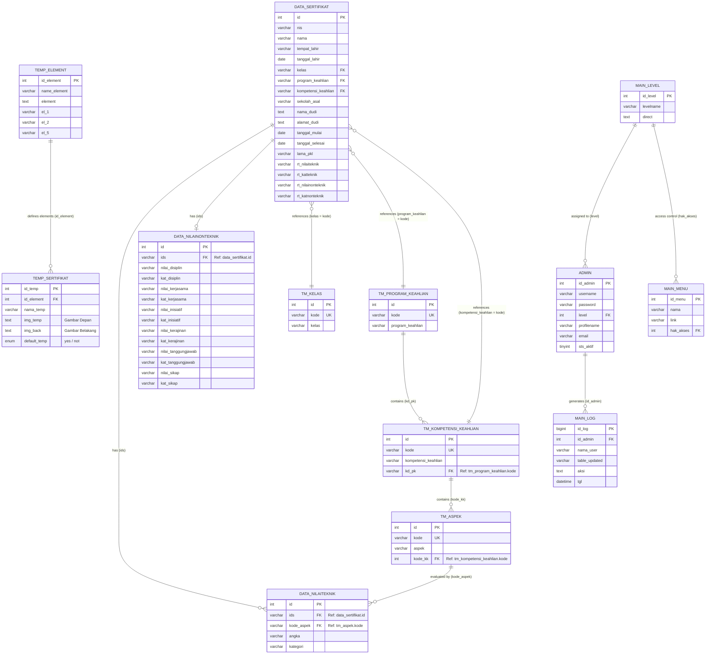

<div align="center">

# 🎓 E-Certificate Management System
### Sistem Informasi Pengelolaan & Cetak Piagam/Sertifikat Digital Massal

[](https://github.com/bagussatoto/Sertifikat/releases)
[](https://www.php.net/)
[](https://codeigniter.com/)
[](https://www.mysql.com/)
[](LICENSE)

<p align="center">
  Aplikasi berbasis web modular (HMVC) yang dirancang untuk membantu sekolah, universitas, maupun lembaga pelatihan dalam mengelola data peserta, nilai kompetensi, serta melakukan pencetakan sertifikat fisik/digital secara otomatis, efisien, dan massal.
</p>

[Fitur Utama](#-fitur-utama) •
[Teknologi](#-teknologi-yang-digunakan) •
[Diagram ERD](#-diagram-erd-entity-relationship-diagram) •
[Prasyarat](#-prasyarat-sistem) •
[Instalasi](#-panduan-instalasi) •
[Konfigurasi](#-konfigurasi) •
[Kontribusi](#-kontribusi--dukungan)

---

</div>

## 📌 Sekilas Aplikasi

**E-Certificate Management System** menyederhanakan siklus pembuatan sertifikat mulai dari pengumpulan data peserta, penilaian teknis/non-teknis, hingga pencetakan dokumen PDF beresolusi tinggi. Dilengkapi dengan dukungan kustomisasi template gambar latar (depan & belakang), sistem ini fleksibel untuk berbagai format kegiatan seperti Praktik Kerja Lapangan (PKL), seminar, workshop, maupun pelatihan kejuruan.

---

## ✨ Fitur Utama

| Modul / Fitur | Deskripsi |
| :--- | :--- |
| 📊 **Dashboard Analitik** | Ringkasan statistik data sertifikat terdaftar, distribusi kelas, dan kompetensi keahlian secara *real-time*. |
| 📥 **Import & Export Massal** | Mendukung import data peserta beserta nilai langsung dari berkas Excel (`.xlsx`) dan export rekap data. |
| 🖨️ **Cetak Fleksibel & Cepat** | Cetak perorangan, seleksi khusus via checkbox, atau cetak massal (*bulk print*) dengan pratinjau instan (*Inline PDF Stream*). |
| 🎨 **Template Kustom** | Kelola desain border/background depan dan belakang sertifikat sesuai identitas visual instansi. |
| 🛡️ **Autentikasi Modern** | Sistem login dengan verifikasi password hybrid (`password_hash` & `password_verify` standar PHP) serta proteksi sesi terisolasi. |
| 📱 **Antarmuka Responsif** | Desain UI adaptif berbasis AdminLTE & Bootstrap yang optimal diakses melalui desktop, tablet, maupun smartphone. |

---

## 🛠️ Teknologi yang Digunakan

- **Backend**: [PHP 7.4](https://www.php.net/)
- **Framework**: [CodeIgniter 3 (HMVC Pattern)](https://codeigniter.com/)
- **Database**: [MySQL 5.7+ / MariaDB 10.3+](https://mariadb.org/)
- **PDF Engine**: [HTML2PDF / TCPDF](https://github.com/spipu/html2pdf)
- **Spreadsheet Parser**: [PHPExcel](https://github.com/PHPOffice/PHPExcel)
- **Frontend & UI**: Bootstrap, AdminLTE, jQuery, DataTables, FontAwesome

---

## 📊 Diagram ERD (Entity Relationship Diagram)

Struktur skema relasional basis data yang menghubungkan data peserta sertifikat, penilaian kompetensi, master jurusan, serta manajemen template sertifikat:



---

## 📋 Prasyarat Sistem

Sebelum memasang aplikasi, pastikan environment web server Anda memenuhi kriteria berikut:

- **Web Server**: Apache / Nginx (XAMPP, Laragon, atau Linux Server)
- **Versi PHP**: **PHP 7.2 - 7.4** *(Sangat direkomendasikan PHP 7.4)*
- **Ekstensi PHP Aktif**:
  - `mysqli`
  - `mbstring`
  - `gd` *(untuk manipulasi aset gambar sertifikat)*
  - `zip` & `xml` *(untuk pengolahan file Excel)*
- **Apache Modules**: `mod_rewrite` aktif

---

## 🚀 Panduan Instalasi

### 1. Clone Repositori
Buka terminal dan arahkan ke direktori web server lokal Anda (`htdocs` pada XAMPP atau `www` pada Laragon):

```bash
# Contoh untuk XAMPP di Windows
cd C:/xampp/htdocs

# Clone repositori
git clone https://github.com/bagussatoto/Sertifikat.git sertifikat
cd sertifikat
```

### 2. Setup Database
1. Buka antarmuka pengelola basis data Anda (misal: **phpMyAdmin** di `http://localhost/phpmyadmin`).
2. Buat basis data baru bernama:
   ```sql
   CREATE DATABASE sertifikat CHARACTER SET utf8 COLLATE utf8_general_ci;
   ```
3. Import berkas skrip SQL yang telah disediakan:
   ```text
   db_sertifikat/sertifikat.sql
   ```

---

## ⚙️ Konfigurasi

### 1. Koneksi Database
Buka file `application/config/database.php`. Konfigurasi database sudah mendukung fleksibilitas environment variables dan konfigurasi lokal:

```php
$db['default'] = array(
    'hostname' => 'localhost',
    'username' => 'root',      // Sesuaikan username database Anda
    'password' => '',          // Sesuaikan password database Anda
    'database' => 'sertifikat',  // Nama database
    'dbdriver' => 'mysqli',
    ...
);
```

> **Tips:** Anda juga dapat menyalin `.env.example` menjadi `.env` jika web server Anda mendukung pembacaan environment variables sistem (`DB_HOST`, `DB_USER`, `DB_PASS`, `DB_NAME`).

### 2. Base URL
Secara bawaan, aplikasi sudah mendukung *auto-detect base URL*. Jika Anda menempatkan proyek di subdomain atau subdirektori spesifik, sesuaikan pada `application/config/config.php`:

```php
$config['base_url'] = 'http://localhost/sertifikat/';
```

---

## 🖥️ Menjalankan Aplikasi & Kredensial

1. Pastikan modul **Apache** dan **MySQL** pada XAMPP/Laragon sudah berjalan (*running*).
2. Buka browser dan akses alamat aplikasi:
   ```text
   http://localhost/sertifikat/
   ```
3. Masuk ke panel administratif melalui:
   ```text
   http://localhost/sertifikat/login
   ```
   - **Username**: `admin`
   - **Password Default**: `admin123` *(atau sesuaikan dengan database Anda)*

> **Catatan Reset Password:**  
> Jika Anda lupa atau ingin menyetel ulang kata sandi admin secara cepat melalui phpMyAdmin/SQL:
> ```sql
> UPDATE `admin` SET `password` = MD5('admin123') WHERE `username` = 'admin';
> ```
> *(Sistem otomatis memverifikasi hash MD5 maupun password_hash modern saat login).*

---

## 📁 Struktur Direktori

```text
Sertifikat/
├── application/
│   ├── config/          # Konfigurasi sistem, routes, dan database
│   ├── controllers/     # Controller utama
│   ├── core/            # Ekstensi core loader & router HMVC
│   ├── helpers/         # Helper kustom (tanggal, slug, xss)
│   ├── libraries/       # Pustaka utilitas (Tanggal, Excel, Upload)
│   ├── modules/         # Arsitektur modular (login, data_sertifikat, dll)
│   └── views/           # Layout master & template view
├── db_sertifikat/       # Berkas database SQL dump
├── static/              # Third-party library (HTML2PDF engine)
├── theme/               # Asset frontend (CSS, JS, ikon, background template)
├── .env.example         # Template konfigurasi environment
├── format.xlsx          # Format standar berkas Excel untuk import data
└── README.md            # Dokumentasi proyek
```

---

## 👥 Pengembang & Pembuat

Aplikasi ini dikembangkan dengan dedikasi untuk mendukung digitalisasi administrasi pendidikan dan sertifikasi keahlian.

- **Developer**: [Bagus Budi Satoto](https://github.com/bagussatoto)
- **Institusi**: Universitas Amikom Yogyakarta (Teknik Informatika)
- **Surel**: `Bagusbudi1308@gmail.com`

---

## 🤝 Kontribusi & Dukungan

Kontribusi selalu terbuka untuk perbaikan fitur, optimasi performa, maupun pembaruan sistem!

1. **Fork** repositori ini.
2. Buat *feature branch* baru (`git checkout -b fitur/fitur-baru`).
3. Lakukan *commit* perubahan (`git commit -m 'feat: menambahkan fitur cetak barcode'`).
4. *Push* ke branch Anda (`git push origin fitur/fitur-baru`).
5. Buat **Pull Request**.

Jika Anda menemukan kendala atau memiliki ide pengembangan, silakan laporkan melalui halaman **[GitHub Issues](https://github.com/bagussatoto/Sertifikat/issues)**.

---

<div align="center">
  <sub>Dikelola dengan ❤️ oleh <a href="https://github.com/bagussatoto">Bagus Budi Satoto</a>. Hak cipta dilindungi undang-undang.</sub>
</div>
